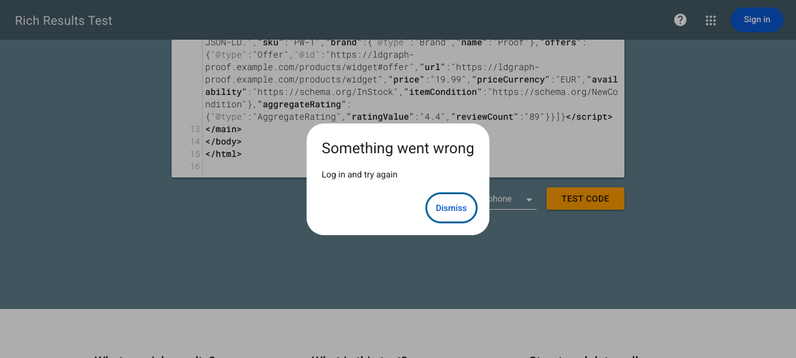
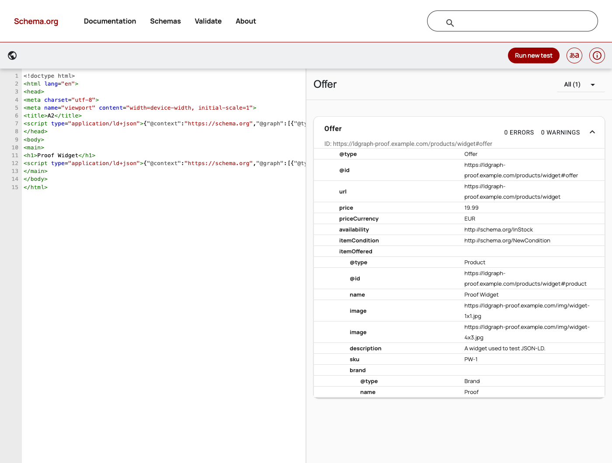
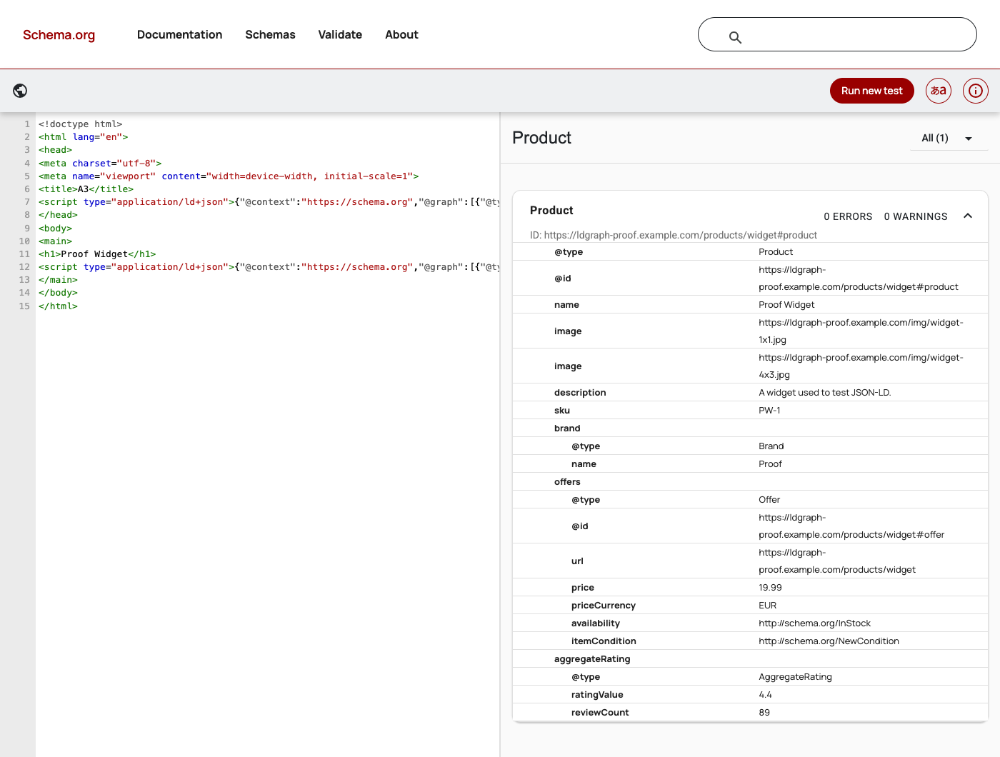
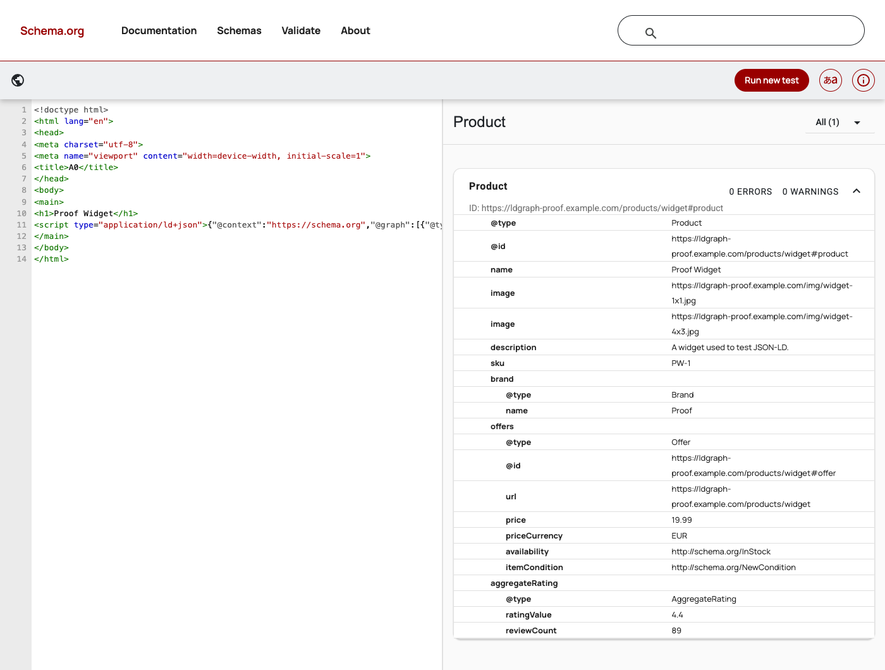

# Verification: does Google join `@id`s across script blocks?

jsonld-stitch renders one block per layout or page and links them by absolute `@id`. JSON-LD 1.1 treats
the blocks on a page as one dataset, and Google's docs say to link items with `@id`, but none of
Google's examples spans two `<script>` elements. This page records what has been checked, with
which tool, and what is still open.

## Status (2026-11-15)

| Question | Evidence | Status |
| --- | --- | --- |
| Do the blocks form one graph under the JSON-LD spec? | jsonld.js, the reference processor, in `npm test` | **Yes**, when the blocks are merged as JSON-LD 1.1 §7.3 describes. See the caveat on the literal API algorithm [below](#the-json-ld-reference-processor-automated). |
| Does Google's Schema Markup Validator join a Product split across blocks? | validator.schema.org, 3 split pages and 1 control | **Yes**, in all three link styles tested |
| Does it join an Article, BreadcrumbList or Event split across blocks? | validator.schema.org | **Not tested**: the validator blocked the test machine before those runs |
| Does the Rich Results Test (Google Search eligibility) join blocks? | search.google.com/test/rich-results | **Not tested**: the test needs a signed-in browser |
| Does a real CMS graph survive jsonld-stitch unchanged? | `examples/drupal-canvas`, 15 pages of a Drupal Canvas site | **Yes**, but every page had at most one block, so this says nothing about joining |

Until the Rich Results Test has been run, the README keeps its advice to put the properties a rich
result needs on the page's own node.

## Google's tools

Run on 2026-11-15 against jsonld-stitch 0.1.0 (commit 5a2e369), from headless Chrome on a build machine,
in one browser session.

### Test pages

[`verification/pages/`](verification/pages) holds the 11 pages that were tested or are still to be
tested. [`verification/gen-pages.mjs`](verification/gen-pages.mjs) renders them with the real
`<JsonLd>` component through `react-dom/server`, so each block is byte for byte what jsonld-stitch emits,
and checks that `serialize()` returns the same string. On the commit that adds this page, running it
regenerates identical files:

```sh
npm run build && NODE_ENV=production node docs/verification/gen-pages.mjs
```

In every split page, block 1 sits in `<head>` (where a root layout puts it) and block 2 in `<body>`
(the page). Each case has a one-block control with the same nodes.

| Page | Block 1 (`<head>`) | Block 2 (`<body>`) |
| --- | --- | --- |
| A0 control | (none) | Product with `offers` and `aggregateRating` |
| A1 same `@id` | Product `#product` (name, image, sku, brand) | `{ "@id": "…#product", offers, aggregateRating }`, no `@type` |
| A2 back-reference | Product `#product` | Offer `#offer` with `itemOffered: ref(product)` |
| A3 forward ref | Product with `offers: ref(offer)` and `aggregateRating` | Offer `#offer` (price, currency, availability) |
| B0 control | (none) | Organization, WebSite, Person, Article |
| B1 split | Organization, WebSite, Person | Article with `publisher: ref(org)`, `author: ref(person)` |
| C0 control | (none) | site nodes, 3 WebPages, BreadcrumbList whose ListItems have no `name` |
| C1 split, no names | Organization, WebSite, 3 WebPages (with `name`) | BreadcrumbList, ListItem `item: ref(webpage)`, no `name` |
| C2 split, named | same as C1 | same as C1, plus `name` on each ListItem |
| D0 control | (none) | Organization, Place, Event |
| D1 split | Organization, Place `#venue` (name, address) | Event with `location: ref(place)`, `organizer: ref(org)` |

### Rich Results Test: blocked, no data

The A0 control was pasted into the CODE tab, and the paste was confirmed on screen. TEST CODE answered
"Something went wrong. Log in and try again", with an invisible reCAPTCHA on the page. No retry,
sign-in or captcha attempt was made. **The Rich Results Test produced no result for any page.**



### Schema Markup Validator: Product joined, the rest not run

Each page was pasted into the "Code snippet" tab of [validator.schema.org](https://validator.schema.org/).
The run confirmed that the editor showed every `<script>` block byte for byte, then expanded and saved
every result item. On the B1 submission the validator answered "There was an error
validating your markup." and the browser was redirected to Google's "unusual traffic" page with a
reCAPTCHA, so the runs stopped there.

The validator lists only root nodes. A node that another node references is shown nested inside it,
with its own properties. So when a referenced node's properties appear under the referencing
property, the validator read them from the other `<script>` element; it did not just echo the `@id`.

| Page | Items found | Errors / warnings | Properties from the other block attached? |
| --- | --- | --- | --- |
| A0 control | 1: Product | 0 / 0 | n/a (one block): `offers` (19.99 EUR) and `aggregateRating` (4.4, 89) on the Product |
| A1 same `@id` | 1: Product | 0 / 0 | **Yes.** One Product with name, image, sku and brand from block 1 and offers and aggregateRating from block 2. Unjoined, there would be 2 items, one without a type. |
| A2 back-reference | 1: Offer | 0 / 0 | **Yes.** `itemOffered` shows the whole Product from block 1 (name, both images, description, sku, brand). |
| A3 forward ref | 1: Product | 0 / 0 | **Yes.** `offers` shows the whole Offer from block 2 (19.99, EUR, InStock, NewCondition). |
| B0 control | 1: Article | 0 / 0 | n/a (one block): `author` resolves to the Person, `publisher` to the Organization with its logo |
| B1 split | not run | | blocked: error dialog, then the "unusual traffic" page |
| C0, C1, C2 | not run | | blocked |
| D0, D1 | not run | | blocked |

| A1: one Product with both blocks' properties | A2: the Offer's `itemOffered` is block 1's Product |
| --- | --- |
|  |  |

| A3: `offers` is block 2's Offer | A0: the one-block control |
| --- | --- |
|  |  |

The B0 control (one block, an Article with author and publisher resolved) is in
[`verification/smv-B0-article-control.webp`](verification/smv-B0-article-control.webp).

**What this proves:** Google's Schema Markup Validator joins a Product split across two
`application/ld+json` blocks, whether the second block adds properties to the same `@id`, points back
with `itemOffered`, or is the target of an `offers` ref. A1 and A3 give the same item as the
one-block control. **What it does not prove:** that the Rich Results Test or Google Search does the
same, or that the validator joins Article, BreadcrumbList or Event nodes. The validator checks
schema.org markup; it does not decide rich result eligibility.

### Still to do (a person with a signed-in browser)

1. Open the [Rich Results Test](https://search.google.com/test/rich-results) signed in, and paste each
   file in [`verification/pages/`](verification/pages) into the CODE tab: at least A0 to A3, B0, B1,
   C0, C1, D0 and D1.
2. Record the detected types, the valid and invalid item counts, and every error. What to look for:
   - **A1**: one valid Product snippet means Google joins the blocks. A Product that reports "Either
     offers, review or aggregateRating should be specified" means it does not.
   - **C1**: a missing ListItem `name` error means `item` refs are not followed across blocks (C0 is
     the one-block baseline for the same markup).
   - **D1**: a missing `location.address` error means the Place in block 1 was not joined.
3. Re-run B1, C0 to C2, D0 and D1 in the Schema Markup Validator from a normal browser.
4. Fill in the table below and update the README's [Google notes](../README.md#google-notes).

| Date | Tool | Pages | Joined across blocks? | Notes |
| --- | --- | --- | --- | --- |
| 2026-11-15 | Schema Markup Validator | A0–A3, B0 | **Yes** for A1, A2, A3 (Product) | B1, C and D blocked before running |
| 2026-11-15 | Rich Results Test | none | not tested | needs sign-in and reCAPTCHA |
| | Rich Results Test | | | |
| | Schema Markup Validator | B1, C0–C2, D0–D1 | | |

## The JSON-LD reference processor (automated)

`test/jsonld.test.ts` runs [jsonld.js](https://github.com/digitalbazaar/jsonld.js), the reference
processor, over HTML the example app serves from `next build` (saved in `test/fixtures/app-router`;
the e2e run fails if the build stops serving those blocks) and over the README's example, rendered.
It runs in `npm test`, offline, in well under a second. It settles what the spec says, not what
Google does:

- **Read as JSON-LD 1.1 §7.3 describes** (each block processed, then merged into one dataset): the
  blocks form one default graph. A node split over blocks (`/split`: a Product in one block, its
  `offers` and `review` in two others) is one node with every property; every `ref()` resolves to a
  node with a `@type`; and the canonical (RDFC-1.0) dataset equals the same nodes in one block.
- **Read by the literal API algorithm** (JSON-LD 1.1 API §9.4.1 with `extractAllScripts`, as the W3C
  test `html/r004` pins down): a block written as `{"@context", "@graph"}`, which is how `serialize()`
  writes every block, becomes its own graph named by a blank node. The triples are the same, but they
  sit in one named graph per block and none in the default graph, so a consumer that reads only the
  default graph, or one graph at a time, does not see the split Product as one node. A block whose
  content is an array of nodes, each with its own `@context`, stays in the default graph.

The Schema Markup Validator runs above used blocks in this `{"@context", "@graph"}` form, and it
joined them, so this caveat did not affect Google's validator. jsonld-stitch's output format is unchanged.

## A real CMS graph (`examples/drupal-canvas`)

On 2026-11-15, `examples/drupal-canvas` (Next 16, `next start`) rendered 15 pages of a local Drupal
Canvas development site from its content API, and `scripts/verify.mjs` compared each served page with
the API:

- On all 15 pages (14 with one JSON-LD block, 1 with none), the served block parses back to exactly
  the API's graph (deep equality), with 0 `check()` issues and every title, meta and link tag present.
  The graphs hold Organization, ImageObject, WebSite, WebPage and, on 5 pages, Article.
- Real text containing `&` and `<` was served as `&` and `<`, and no block held a raw `<`,
  `>`, `&`, U+2028 or U+2029.
- Headless Chromium on `next start` and `next dev` logged no hydration warnings, page errors or
  `[jsonld-stitch]` warnings, and `check()` on the live DOM after hydration found nothing.
- Negative control: changing one value ("Home" to "Hone") in the served HTML made the script report a
  mismatch and exit 1.

This shows that jsonld-stitch carries a real CMS graph through unchanged and safely escaped. No page had
more than one block, so it is no evidence about joining across blocks.
